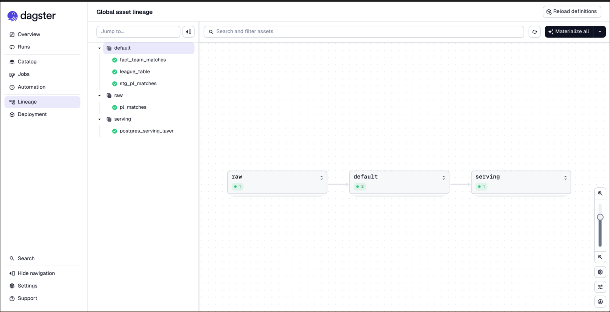
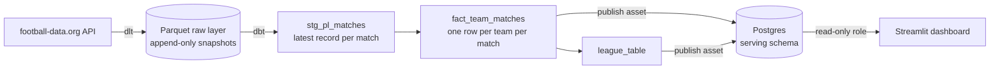

# Premier League Data Warehouse

An end-to-end data engineering project that ingests Premier League match data, models it into a tested analytics layer, and serves it through a dashboard. The pipeline refreshes itself on a schedule, and the current season updates as matches are played.

**Stack:** Python · dlt · Parquet · DuckDB · dbt · Dagster · PostgreSQL · Streamlit · Docker Compose · uv





## Architecture



Dagster orchestrates every step as an asset, so the whole lineage from the API call to the Postgres tables is one graph. A daily schedule runs the full job.

## Stack and why

| Layer | Tool | Why |
|---|---|---|
| Ingestion | Python + [dlt](https://dlthub.com) | Schema inference, nested JSON flattening, retries, and load tracking without hand-written plumbing |
| Raw storage | Parquet files | Columnar, cheap, engine-independent, and replayable |
| Transformation | DuckDB + dbt | Embedded columnar engine that fits this data size; dbt adds tests, lineage, and documented models |
| Orchestration | Dagster | Asset-based model that maps cleanly onto dbt and gives data quality checks a home |
| Serving | PostgreSQL 17 | Handles concurrent readers, which DuckDB's single-writer model cannot |
| Dashboard | Streamlit | Python-native, quick to build |
| Environment | uv, Docker Compose | Reproducible dependencies; Postgres runs as a container with a named volume and healthcheck |

## Data model

| Layer | Model | Grain | Notes |
|---|---|---|---|
| Raw | `football_data/pl_matches` (Parquet) | one row per match per ingestion | Append-only; never edited |
| Staging | `stg_pl_matches` (view) | one row per match | Latest snapshot per match, columns renamed and typed |
| Mart | `fact_team_matches` (table) | one row per team per finished match | Each match unpivoted to a home and an away row |
| Mart | `league_table` (table) | one row per team per season | Points, goal difference, and rank |
| Serving | `serving.league_table`, `serving.fact_team_matches` | same as above | Copied into Postgres after each dbt build |

## Data quality

- **13 dbt data tests** run on every build: uniqueness and not-null on keys, and accepted values for match status, plus the domain tests below.
- **Domain tests:** finished matches always have scores, each season has exactly 380 matches, and total goals for equal total goals against within a season.
- **Reconciliation on publish:** the Dagster asset that copies tables into Postgres fails if the row counts differ from DuckDB.
- **Visible in Dagster:** dbt tests appear as asset checks attached to the models they cover.

## Key design decisions

**Append-only raw layer, deduplicated downstream.** Matches change over time (status, kickoff time, score), so each run appends a full snapshot stamped with an ingestion timestamp. Staging keeps the newest record per match. Raw stays an immutable audit log and any bug can be fixed by replaying from it. The cost is some duplicated rows in storage, which is negligible at this scale.

**DuckDB for transformation, Postgres for serving.** DuckDB allows one writer at a time, and a running pipeline holds the lock on its database file. A dashboard reading that file would fail during refreshes. Publishing the final marts into Postgres lets the dashboard read independently of the pipeline.

**Fact table at the lowest useful grain.** Unpivoting each match into two team-level rows makes league tables, form, and home/away splits simple aggregations, and keeps the scoring rule (3/1/0) defined in exactly one place.

**Least privilege for the dashboard.** The app connects as a read-only Postgres role, and default privileges ensure grants survive the tables being dropped and recreated on each publish.

**Explicit types at the boundary.** Aggregates are cast to integers in the marts, so the types written to Postgres are chosen deliberately rather than inherited from DuckDB's wide integer defaults.

**Self-contained, parameterized configuration.** The dbt profile lives in the project and reads its paths from environment variables, so the same code runs from the command line, under Dagster, and in a container.

## Getting started

Prerequisites: [uv](https://docs.astral.sh/uv/), Docker with Compose, and a free API token from [football-data.org](https://www.football-data.org). Developed on Python 3.14.

```bash
git clone https://github.com/justincox8/Premier-League-Warehouse.git
cd Premier-League-Warehouse
uv sync

# Configure secrets: FOOTBALL_DATA, POSTGRES_DB, POSTGRES_USER,
# POSTGRES_PASSWORD, DASHBOARD_PASSWORD
cp .env.example .env

# Start Postgres and create the read-only dashboard role
docker compose up -d
set -a; source .env; set +a
docker compose exec -T postgres psql -U "$POSTGRES_USER" -d "$POSTGRES_DB" \
  -v pw="$DASHBOARD_PASSWORD" < sql/dashboard_role.sql

# Start Dagster
export DAGSTER_HOME="$PWD/.dagster" && mkdir -p "$DAGSTER_HOME"
uv run dagster dev -f definitions.py
```

1. Open http://localhost:3000.
2. Materialize the raw asset with `seasons: [2025, 2026]` in the launchpad config to backfill the previous and current season.
3. Materialize all assets to build the marts and publish them to Postgres.
4. Turn on the `refresh_pl_warehouse_schedule` schedule (daily at 06:00, America/Los_Angeles).

Run the dashboard in a second terminal:

```bash
set -a; source .env; set +a
uv run streamlit run dashboard.py   # http://localhost:8501
```

To run only the dbt layer: `cd pl_dbt && uv run dbt build`.

## Project structure

```
pl-warehouse/
├── definitions.py          # Dagster assets, resources, job, and schedule
├── ingest_matches.py       # dlt pipeline: API to Parquet
├── dashboard.py            # Streamlit app (reads from Postgres)
├── docker-compose.yml      # Postgres serving layer
├── sql/dashboard_role.sql  # Read-only role for the dashboard
├── pl_dbt/                 # dbt project: models/staging, models/marts, tests
├── raw/                    # Parquet raw layer (gitignored)
├── .env.example            # Required environment variables
└── pyproject.toml, uv.lock
```

## Known limitations

- Rankings use points, goal difference, then goals scored. The real league applies further tiebreakers such as head-to-head, and a results-only model cannot see points deductions.
- The free API tier delays scores and is rate limited, so very recent results can lag.
- The schedule only fires while the Dagster process is running.
- Match-level data only; there is no player or event-level data yet.

## Roadmap

- [ ] Containerize Dagster and Streamlit and deploy the full stack with Docker Compose on a home server
- [ ] CI with GitHub Actions: lint, `dbt parse`, and `dbt build` against a small fixture dataset
- [ ] `dim_teams` and an API standings endpoint to cross-check the computed league table
- [ ] Migrate the warehouse layer to Snowflake and document the changes and costs
